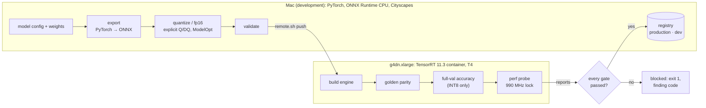
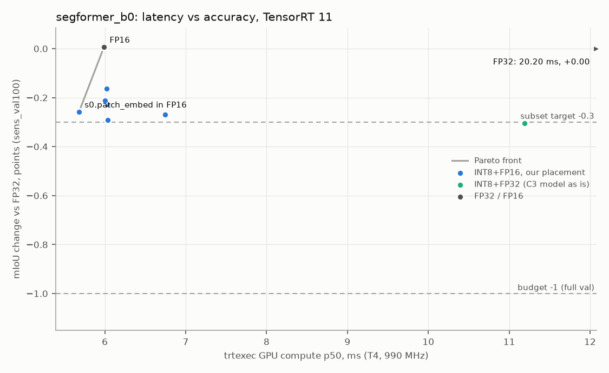
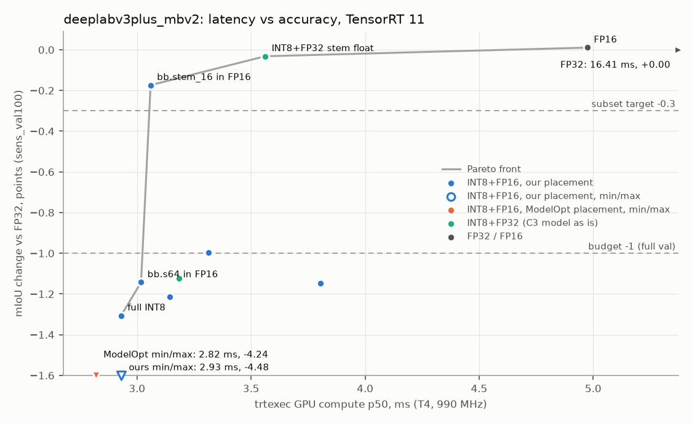

# edgeinfer

Tools and experiments for taking PyTorch segmentation models to TensorRT under real-time latency, accuracy and memory budgets, with the tooling to prove the optimized model is still correct.

**Task.** Cityscapes semantic segmentation, batch 1, RGB 3×512×1024, 19 classes, mIoU on the 500 val images. Two architectures on purpose: **SegFormer-B0** (a transformer) and **DeepLabV3+ MobileNetV2** (a CNN). CNNs usually quantize to INT8 cleanly; transformers tend to degrade at LayerNorm, softmax and attention.

**Budgets** (`configs/budgets.yaml`), on an NVIDIA T4 (g4dn.xlarge):
- engine `infer` p99 ≤ 33.3 ms (one frame at 30 FPS);
- mIoU drop ≤ 1.0 point vs FP32 at the same resolution, on full val;
- GPU memory ≤ 953 MiB (1 GB).

## What it does

| Tool | Command | What it reports |
|---|---|---|
| Validator | `edgeinfer validate` | An exported ONNX model's ops, shapes, dtypes, weights, Q/DQ placement, and whether its embedded preprocessing contract matches the config. |
| Performance probe | `edgeinfer perf` | Latency distribution per span (preprocess, H2D, `infer`, D2H, postprocess, e2e), throughput, device memory, engine size, at a locked GPU clock. |
| Parity analyzer | `edgeinfer parity` | Any backend's outputs vs FP32 golden outputs: whole model and per layer, logits, argmax agreement, mIoU on 32 golden images. |
| Sensitivity analyzer | `edgeinfer sensitivity` | Ranks layer groups by mIoU impact under INT8, and proposes which to keep in float. |
| Gated deployment | `edgeinfer deploy run\|rollback\|status` | export → convert → validate → build → parity → accuracy → perf → publish, with reuse of unchanged stages, a registry and rollback. An Airflow DAG wraps it. |

Every tool is a library function plus a CLI command that writes a JSON report: a stable envelope with the git SHA, environment, thresholds, metrics and [documented finding codes](docs/report-codes.md). Tools talk to a `Backend` (`torch_ref`, `ort_cpu`, `trt`), never to a runtime directly. Preprocessing is config-driven, and artifacts are content-addressed: an id is a hash of the weights, configs and toolchain.



## Results

<!-- results:start -->
<!-- Generated by scripts/make_results.py; don't edit by hand. -->
| Model | Engine | mIoU | vs FP32 | `infer` p99 (ms) | GPU memory (MiB) | engine file (MiB) |
|---|---|---|---|---|---|---|
| SegFormer-B0 | FP32 | 70.577 | — | 25.919 | 427 | 15.7 |
| SegFormer-B0 | **FP16 (final)** | 70.583 | +0.006 | 9.548 | 299 | 15.7 |
| SegFormer-B0 | INT8+FP16, s0.patch_embed in FP16 (best INT8) | 70.474 | −0.103 | 9.349 | 269 | 8.4 |
| DeepLabV3+ MobileNetV2 | FP32 | 67.086 | — | 21.743 | 239 | 22.5 |
| DeepLabV3+ MobileNetV2 | FP16 | 67.100 | +0.013 | 8.486 | 193 | 10.4 |
| DeepLabV3+ MobileNetV2 | **INT8+FP16, bb.stem_16 in FP16 (final)** | 66.758 | −0.328 | 6.547 | 179 | 5.8 |

cuda:0 (Tesla T4, sm_75), TensorRT 11.3.0.99, at the 990 MHz clock lock, batch 1; Cityscapes full val at 512×1024. Sources for every cell: [docs/results.md](docs/results.md).
<!-- results:end -->

Every table, its sources, and the profile, sensitivity and pipeline numbers are in [docs/results.md](docs/results.md), generated by `scripts/make_results.py` from the reports named in `configs/results.yaml`.

| SegFormer-B0 | DeepLabV3+ MobileNetV2 |
|---|---|
|  |  |

### Key findings
- **DeepLab deploys in INT8+FP16, with 23% lower latency than FP16, within the accuracy budget.** `infer` p99 6.547 ms vs 8.486 ms, at a cost of 0.328 mIoU points on full val and 0.428 on the 400 held-out images. One layer group, the stem (`bb.stem_16`), stays in FP16. ([final report](artifacts/reports/final__deeplabv3plus_mbv2__acaa81b.json); D-035)
- **SegFormer stays in FP16: INT8 bought 2.1%, inside the 3.5% noise band.** The best INT8 engine ran at 9.349 ms vs 9.548 ms. The per-layer profile shows why: the matrix layers that INT8 speeds up are 41% of SegFormer's FP16 layer time, and TensorRT-generated kernels for the other ops are 43% and don't change, so compute p50 improves only 1.05×. DeepLab gets 1.62×. ([final report](artifacts/reports/final__segformer_b0__acaa81b.json), [profile](artifacts/reports/trtexec__segformer_b0__fp16__c5profile__990MHz__ab77361.json); D-033)
- **Sensitivity analysis recovered DeepLab's INT8 accuracy.** Percentile INT8 on ONNX Runtime lost 1.117 points; keeping one layer group, the stem (`bb.stem_16`), in float brings the loss to 0.219. ([percentile](artifacts/reports/eval__deeplabv3plus_mbv2__ort_cpu__int8_percentile__eval_val__512x1024__cb60f28.json), [with exclusions](artifacts/reports/eval__deeplabv3plus_mbv2__ort_cpu__int8_percentile__sens__eval_val__512x1024__da584fa.json); D-017)
- **A silent TensorRT failure is caught and blocked.** In SegFormer's INT8+FP16 network, the INT8 convolutions TensorRT can't fuse compute wrong values: mIoU on the golden images falls from 71.45 to 0.06 with no build error. Per-layer parity localized it, keeping those nodes in FP16 fixed it (D-034), and the deploy pipeline blocks the faulty recipe at golden parity. ([blocked deploy](artifacts/reports/deploy/segformer_b0__int8fp16_no_unfused/20261017T213435Z/deploy.json))
- **The harness agrees with itself.** FP32 on PyTorch, ONNX Runtime and TensorRT gives the same full-val mIoU to three decimals (SegFormer 70.577, DeepLab 67.086). Reducing the input from 1024×2048 to 512×1024 costs 3.854 and 4.981 points. ([docs/results.md §2](docs/results.md#2-accuracy-across-harnesses))
- **Reruns are fast because nothing is redone.** Deploying DeepLab's final model ran its gates in 1351.7 s; an immediate rerun took 19.6 s, with every stage skipped or reused, and published nothing new. ([cold](artifacts/reports/deploy/deeplabv3plus_mbv2/20261017T205607Z/deploy.json), [rerun](artifacts/reports/deploy/deeplabv3plus_mbv2/20261017T213611Z/deploy.json); D-040)

## Limitations

**The T4 isn't vehicle hardware.** It is a datacenter Turing GPU (compute capability 7.5) on PCIe with its own memory. On an Orin-class module (Jetson AGX Orin), several things change:
- **A different TensorRT.** JetPack 6.2.1 ships TensorRT 10.3, and TensorRT 11 doesn't support JetPack at all ([TensorRT 11.4 release notes](https://docs.nvidia.com/deeplearning/tensorrt/11.4.0/getting-started/release-notes-11/11.4.0.html), [JetPack 6.2.1 release notes](https://docs.nvidia.com/jetson/jetpack/release-notes/index.html)). An engine built with TensorRT 11 doesn't run on an older runtime, and cross-GPU hardware compatibility isn't supported on JetPack ([engine compatibility](https://docs.nvidia.com/deeplearning/tensorrt/latest/inference-library/engine-compatibility.html)). Every engine would be rebuilt and every gate re-run on the device; the pipeline's recipes and gates carry over, its TensorRT backend would need checking against the 10.x API.
- **Unified memory.** CPU and GPU share the same LPDDR5 (256-bit, 204.8 GB/s on the AGX Orin), so device, host and unified allocations are the same physical DRAM and the host↔device copies in the e2e span can be avoided ([CUDA for Tegra](https://docs.nvidia.com/cuda/cuda-for-tegra-appnote/index.html)). The memory budget then competes with the CPU side, and "GPU memory used" means something different.
- **DLA.** The AGX Orin has two NVDLA v2.0 accelerators, which TensorRT can target in FP16 or INT8, with GPU fallback splitting the network where layers aren't supported ([Working with DLA](https://docs.nvidia.com/deeplearning/tensorrt/10.x.x/inference-library/work-with-dla.html)). The supported-layer table has convolution, pooling, resize and elementwise, but no matrix multiply or LayerNorm. DeepLab's convolutions look like a fit; SegFormer's attention and LayerNorms would stay on the GPU. Not measured here.
- **Power modes and clocks.** The 64 GB module runs at 15, 30 or 50 W, or MAXN up to 60 W. Each mode caps frequencies and the number of online GPU TPCs and DLA cores, and the GPU tops out at 1.3 GHz ([technical brief v1.2](https://www.nvidia.com/content/dam/en-zz/Solutions/gtcf21/jetson-orin/nvidia-jetson-agx-orin-technical-brief.pdf)). Latency budgets would be stated per power mode, replacing this project's 990 MHz clock lock (D-027).

**Other limits.**
- **e2e isn't a deployment number.** It includes Python/NumPy preprocessing and full-resolution upsampling and argmax on the CPU, 773–796 ms per frame here. The budget gates the engine's `infer` span (D-026). A C++ runtime with GPU pre- and post-processing is a separate project.
- **One shape, batch 1.** Static 3×512×1024 engines. At that size both models score below their full-resolution results (§2 of the results).
- **TensorRT builds aren't bit-reproducible.** A rebuild can choose different kernels: two builds with identical settings differed by 3.4% in compute time (D-029). That's why the tie band exists, and why gate reuse and the registry track the engine's sha256 as well as its id.
- **Post-training quantization only.** No quantization-aware training, and one calibration set (200 train images).
- **Engines are gone.** The GPU instance was terminated after the project (D-044), so the registry's TensorRT versions can't be rolled back to until rebuilt and re-gated (D-037).

## Reproduce

Needs Python ≥ 3.11 and [uv](https://docs.astral.sh/uv/). Cityscapes (`leftImg8bit` and `gtFine`) comes from [cityscapes-dataset.com](https://www.cityscapes-dataset.com/) under its own license; only image-id manifests are in this repo. Weights download on first use and are checked against their sha256 (`configs/models/`).

```bash
git clone https://github.com/anjmhrjn/edgeinfer && cd edgeinfer
uv sync                                     # main environment
uv sync --project tools/modelopt            # ModelOpt, for FP16 / INT8+FP16 conversion (D-024)
export CITYSCAPES_ROOT=/path/to/cityscapes

# Tests and the results page (no data needed)
uv run pytest -m "not gpu and not data and not weights and not modelopt and not airflow"
uv run python scripts/make_results.py --check     # docs/results.md matches the reports

# On the Mac (ONNX Runtime CPU): DeepLab's final model, from nothing
uv run edgeinfer golden --model deeplabv3plus_mbv2   # FP32 reference outputs, checked against data/golden_hashes/
uv run edgeinfer deploy run --recipe configs/deploy/deeplabv3plus_mbv2__ort_cpu.yaml --dry-run
uv run edgeinfer deploy run --recipe configs/deploy/deeplabv3plus_mbv2__ort_cpu.yaml
```

**On a T4** (TensorRT 11.3 in an NGC container, D-020/D-023). `scripts/gpu-create.sh` prints what it would create (an EC2 g4dn.xlarge, billable) and only creates it with `--yes`.
```bash
scripts/gpu-create.sh --yes && scripts/gpu-up.sh
scripts/remote.sh push-data                          # Cityscapes val, to the private instance only
uv run edgeinfer golden --model segformer_b0         # then push both models' golden outputs
scripts/remote.sh push-artifacts artifacts/golden
uv run edgeinfer deploy run --recipe configs/deploy/deeplabv3plus_mbv2.yaml   # INT8+FP16
uv run edgeinfer deploy run --recipe configs/deploy/segformer_b0.yaml         # FP16
scripts/gpu-down.sh
```
The fault recipes in `configs/deploy/faults/` show a blocked deployment. The Airflow DAG (`pipelines/airflow/dags/deploy_model.py`) runs the same stages from its own environment (`uv sync --project tools/airflow`, D-038).

## Licenses
- This repository's code: [MIT](LICENSE).
- DeepLabV3+ model code, vendored from [VainF/DeepLabV3Plus-Pytorch](https://github.com/VainF/DeepLabV3Plus-Pytorch): MIT ([license](src/edgeinfer/models/third_party/deeplabv3plus/LICENSE)). Its Cityscapes checkpoint is downloaded from the upstream release.
- SegFormer-B0 weights ([nvidia/segformer-b0-finetuned-cityscapes-1024-1024](https://huggingface.co/nvidia/segformer-b0-finetuned-cityscapes-1024-1024)): the NVIDIA Source Code License for SegFormer, non-commercial (research or evaluation) use only. They're downloaded, never redistributed.
- Cityscapes: its license prohibits redistribution. No images, labels or derived tensors (golden outputs, calibration caches) are committed; only image-id manifests.

## More
[Roadmap](docs/roadmap.md) · [progress and per-checkpoint results](docs/progress.md) · [decision records](docs/decisions.md) · [report codes](docs/report-codes.md) · [ideas left out](docs/ideas.md)
